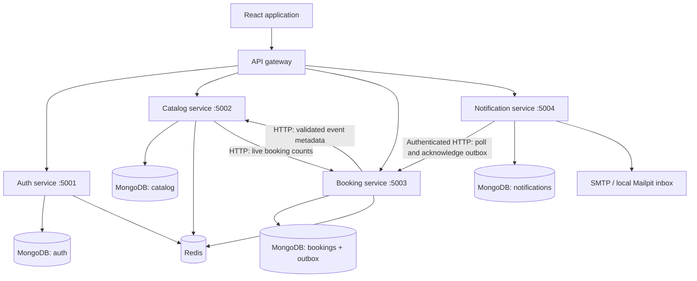
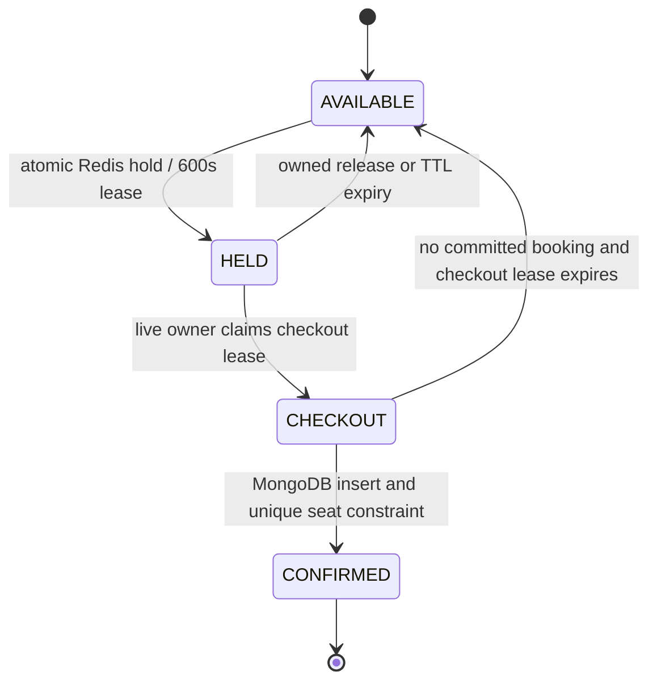

# EventPass — Implemented System Design

## Problem and idea

College events have limited seats. Concurrent requests must not sell one seat twice. EventPass lets students discover events, hold a seat for ten minutes, confirm a mock checkout, and receive a QR ticket.

## Architecture

The gateway is NGINX in Docker and a Node HTTP proxy in local development. API instances carry an `X-Instance-Id` response header. Independent database names provide logical service ownership; this lab deployment uses one MongoDB server and one Redis server.

## Service ownership

| Service | Owns | API prefix |
| --- | --- | --- |
| Auth | Users, password hashes, JWT issuing | `/api/auth` |
| Catalog | Events and layouts | `/api/catalog` |
| Booking | Holds, confirmed tickets, email outbox | `/api/booking` |
| Notification | SMTP attempts and delivery records | `/api/notifications` |

## Seat lifecycle

### Hold

1. Verify JWT. Ignore any client-supplied user identity.
2. Fetch the event from the catalog service. Validate the seat against its real layout and reject past events.
3. Reject an already confirmed seat using the booking database.
4. Run a Redis Lua script. Remove expired hold entries, check existing ownership, reconcile advisory inventory, and acquire the individual seat lease with `SET NX PX 600000`.
5. Record the lease expiry in a per-event sorted set and atomically decrement advisory inventory. Repeating a hold by the same owner returns its remaining time without renewing it.

### Confirm

1. Require an `Idempotency-Key`. Return the saved ticket if this user already completed the same request for the same event and seat.
2. Fetch server-owned event data; take the price, title, venue and date from the catalog, not the request.
3. Atomically compare the Redis lease owner and claim a short checkout lease. Reject missing, expired or other-user holds.
4. Generate a cryptographically random ticket code and local PNG QR code.
5. Insert one MongoDB document containing the booking and `outbox.status=PENDING`. The unique confirmed event/seat index is the durable backstop against overselling; the unique user/request index handles retries.
6. Release the checkout lease with atomic compare-and-delete. A cleanup failure never changes a successful durable insert into a reported booking failure.
7. Return the saved ticket. Email processing occurs separately.

A claim can expire while a database operation is delayed. Another claimant may then attempt the same seat, but the unique database index still permits at most one confirmed record. This design does not claim a transaction spanning MongoDB and Redis. Redis counters are advisory; MongoDB confirmed records determine actual sold inventory.

## Catalog cache-aside

Static event records are cached in Redis for 3,600 seconds. List keys include a monotonically incremented catalog version. Creating an event increments that version, invalidating every category/search list without scanning keys. Search is escaped as a literal regular expression. No seeding occurs inside GET requests.

List responses add fresh confirmed availability from booking counts. Availability is `null` when booking is unreachable rather than displaying a fabricated count. Catalog metadata can still be read from MongoDB if Redis is unavailable; health reports the degraded dependency.

## Durable email delivery

An embedded outbox avoids a booking-success/email-intent race: both are in one document. The notification worker reads pending records through an internal API protected by a separate service secret. It owns a durable delivery record with a unique booking ID, attempt count, retry time, and processing lease.

SMTP success marks the notification `SENT`, then acknowledges the booking outbox. Failed attempts use capped exponential backoff. Cursor-based polling rotates through the pending queue so failed old messages do not permanently block newer ones. A crash between SMTP acceptance and saving `SENT` may resend the message: delivery is at-least-once, not exactly-once. A deterministic SMTP Message-ID aids diagnosis but is not a delivery deduplication guarantee.

Local SMTP points to Mailpit. Messages and QR attachments are visible at `http://localhost:8025`. The worker does not expose a public arbitrary-recipient send-mail endpoint.

## Failure behavior and guarantees

| Failure | Behavior |
| --- | --- |
| Redis unavailable | Booking pauses; authentication rate limiter and link creation fail closed; catalog can read MongoDB |
| MongoDB unavailable | Affected service returns failure; no memory fallback fabricates persistence |
| Mail worker or SMTP unavailable | Tickets remain saved; pending email intent is retried after recovery |
| Response lost after successful booking | Retry with same key returns the same saved ticket |
| Duplicate seat inserts race | Unique confirmed event/seat index rejects all but one |
| Catalog unavailable | New holds/confirmations fail because event/price validation cannot complete |

All routes return structured JSON errors and request IDs. JWT verification restricts algorithm, issuer and audience. Public signup fixes the student role. Mutations validate input; event creation requires admin. Internal APIs are unreachable through the gateway.

## Limits

Mock payments, no cancellation/refund flow, no real admission scanning app, polling rather than WebSockets, logical per-service databases on a single MongoDB server, a single Redis node, and process-local metrics. Health checks are live; performance figures and 5,000-user capacity have not been established by a load test. TTL expiry and cache TTLs are mechanisms, not precise wall-clock scheduling guarantees.

The original planning document is preserved in `docs/INITIAL_SYSTEM_DESIGN.md`. Its aspirational latency, CAP and throughput statements are not measurements of this implementation.
