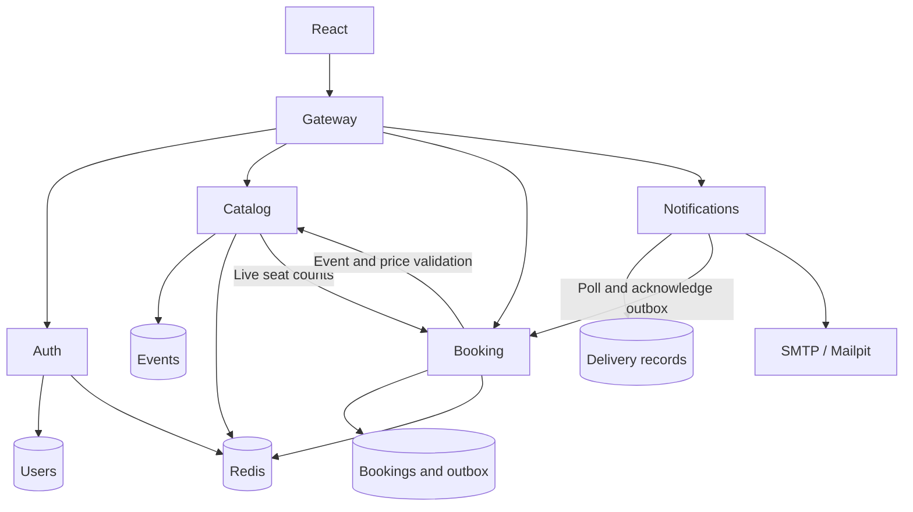

# Architecture

EventPass has a React frontend, four Express services, a gateway, MongoDB and Redis.

| Service | Local port | Owns |
| --- | --- | --- |
| Auth | 5001 | Users, password hashes and JWT issuing |
| Catalog | 5002 | Events and seating layouts |
| Booking | 5003 | Seat holds, confirmed tickets and mail outbox |
| Notifications | 5004 | SMTP attempts and delivery records |
| Gateway | 8080 | Public routing; NGINX replaces the Node proxy in Docker |

Each application service runs as a separate process/container. They use separate logical databases on one MongoDB server. Shared repository helpers and the Docker build create some build-time coupling.

## Consistency

Redis Lua checks and acquires a group of seat leases atomically. Conflicts reject immediately; the application does not wait on several partially acquired locks. Expiring leases recover abandoned holds. MongoDB's unique partial multikey index on confirmed event/seat pairs is the final guard against duplicate tickets.

A booking stores all selected seats and its email intent in one document. This is a single-document atomic write, not a transaction across Redis and MongoDB. The Redis inventory counter is reconciled during holds and is advisory.

Checkout retries use a unique user/request pair. The same key returns the saved booking only for the same event and seat group.

## Catalog

Static metadata uses Redis cache-aside with a one-hour default TTL. A version counter invalidates filtered lists after event creation. Lists add confirmed availability from the booking service; unavailable counts are reported as null rather than guessed.

## Email

The worker polls an authenticated internal booking endpoint. A delivery record tracks attempts, a processing lease and the next retry time. SMTP acceptance is recorded before the outbox is acknowledged. A crash between those steps can duplicate email. No message broker is used.

## Boundaries and deployment

Public requests use JWT authentication where required. Event creation requires admin rights. Internal endpoints require a separate service secret and are not routed through public ingress. NGINX rate limits API traffic.

The local deployment has one instance of each EventPass service, one MongoDB server and one Redis server. Replicated load balancing and production throughput have not been established. The [original planning diagram](system-design.svg) includes performance and deployment targets; those targets are not measured guarantees.
