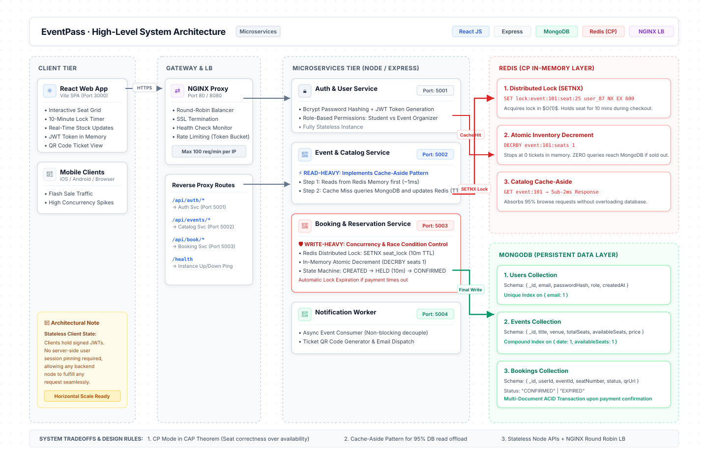
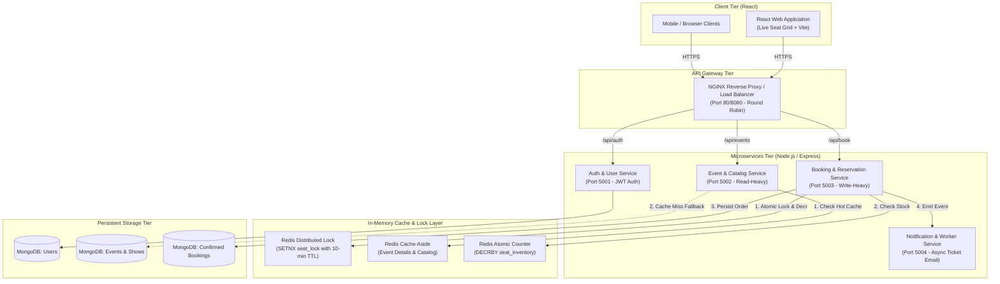

# 🎫 EventPass: High-Concurrency Ticket & Event Booking Platform
## Product Requirements Document (PRD) & System Design Document



> **✏️ Eraser.io Ready:** You can also copy-paste [`eraser_diagram_code.txt`](eraser_diagram_code.txt) directly into [app.eraser.io](https://app.eraser.io) for an interactive live canvas.

---

## 1. Executive Summary
* **Project Name:** **EventPass**
* **Target Stack:** HTML5, CSS3, JavaScript, React.js, Node.js/Express Microservices, MongoDB, Redis, Docker, NGINX.
* **Core Problem Solved:** High-concurrency flash ticket sales (e.g., college fests, concerts, hackathons). When 5,000+ users try to book 50 limited seats simultaneously at 12:00 PM, standard databases face severe race conditions leading to **overselling** and database crashes.
* **Our Solution:** A decoupled microservices architecture with an in-memory **Redis Distributed Locking & Atomic Counter layer** that eliminates overselling in $O(1)$ memory time before any write hits MongoDB.

---

## 2. Requirements Specification

### Functional Requirements (User Features)
1. **User Authentication:** Student/User registration and login with stateless JWT tokens.
2. **Event & Catalog Discovery:** Browse upcoming events, filter by category/date, view real-time seat availability.
3. **Seat Selection & Temporary Hold:** Interactive visual seat grid; selecting a seat puts a **10-minute hold** (`SETNX` lock).
4. **Order Confirmation & Ticket Generation:** Completing mock payment converts temporary hold to a confirmed ticket with a unique QR code.
5. **Auto-Expiration:** If payment is not completed within 10 minutes, the seat is automatically released back to the pool.

### Non-Functional Requirements (Architecture Goals)
1. **Consistency over Availability (CAP Theorem - CP System):** 
   * Strict serializability for seat booking. It is acceptable to reject a request with "Seat Already Taken", but **double-booking is strictly prohibited**.
2. **Ultra-Low Latency:** Catalog reads served in $< 10\text{ ms}$ using Redis Cache-Aside.
3. **Horizontal Scalability:** App servers are completely stateless; traffic is evenly distributed across nodes via NGINX Round-Robin.
4. **Resilience & Fault Tolerance:** If the Notification service goes down, booking still succeeds.

---

## 3. High-Level Architecture (HLD)



---

## 4. Role of Redis in System Design (10/10 Evaluation Answers)

### A. Preventing Race Conditions & Overselling (`SETNX`)
When a student selects Seat #25 for Event #101:
```javascript
// Step 1: Attempt to acquire distributed lock with 10-min expiry (600s)
const isLocked = await redisClient.set(
    `lock:event:101:seat:25`, 
    userId, 
    { NX: true, EX: 600 }
);

if (!isLocked) {
    return res.status(409).json({ error: "Seat is currently reserved by another student." });
}

// Step 2: Atomic Decrement of seat quota
await redisClient.decr(`event:101:availableSeats`);
```
* **Why this is powerful:** Redis is single-threaded and executes commands in memory in nanoseconds. Even if 1,000 requests hit simultaneously, only one succeeds; the other 999 are rejected without touching MongoDB.

### B. Cache-Aside Pattern for Catalog Browsing
```javascript
// 1. Check Redis first (Hot Path)
let event = await redisClient.get(`event:${eventId}`);
if (event) return JSON.parse(event);

// 2. Cold Path (Cache Miss) -> Query MongoDB
event = await EventModel.findById(eventId);
if (event) {
    // 3. Populate Redis with 1-hour TTL
    await redisClient.setEx(`event:${eventId}`, 3600, JSON.stringify(event));
}
return event;
```

---

## 5. Low-Level Design (LLD): Booking State Machine

```
[ AVAILABLE ] ──(Student Selects Seat)──► [ HELD / LOCKED (Redis 10 min) ]
                                                    │
                                ┌───────────────────┴───────────────────┐
                                │ (Payment Success)                     │ (Payment Timeout > 10m)
                                ▼                                       ▼
                       [ CONFIRMED (MongoDB) ]                  [ AUTO-RELEASED ]
                       (Ticket QR Generated)                   (Back to Available)
```

---

## 6. How to Explain in 60 Seconds to Your Evaluator

1. *"Sir/Ma'am, our semester project is **EventPass**, a high-concurrency event and ticket booking platform designed as a microservices architecture using React, Express, MongoDB, and Redis."*
2. *"The key system design challenge we solve is **race conditions and overselling** during flash bookings."*
3. *"Instead of locking rows in MongoDB, which creates massive latency and bottlenecks, we use **Redis Distributed Locking with `SETNX`** and **atomic memory decrement**. This guarantees zero overselling with sub-millisecond response times."*
4. *"For read traffic, we implemented the **Cache-Aside pattern**, offloading 95% of queries from MongoDB to Redis memory."*
5. *"Under the CAP theorem, this system operates in **CP (Consistency & Partition Tolerance)** mode because in financial and seat reservations, accuracy is non-negotiable."*
